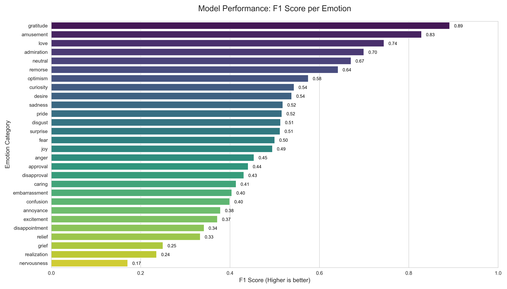

# Emotion Detection in Text

A model that reads a piece of text and predicts which emotions are in it. One
message can have more than one emotion, so each of the 28 GoEmotions labels gets
its own yes or no.

We built this as our Artificial Intelligence course project at FAST University,
Lahore (Semester 6).

- Video: [what this could look like in a support inbox](media/feltline.mp4)
- Technical report: [PDF](docs/technical-report.pdf)

The video is a concept. The inbox, the company and the messages are made up, and
the emotion labels on screen were written by hand. The model is not connected to
that inbox yet.

## Example

```
Input:  "I can't believe she actually did it, I'm so proud"
Output: admiration (92%)  |  joy (81%)  |  surprise (74%)
```

## What we did

We started with BERT. Its validation macro F1 stayed around 0.40 and it began to
overfit, so we moved to DeBERTa-v3-base and fine-tuned the whole model, not only
the last layer.

```
Input text
  -> DeBERTa-v3-base (max length 128)
  -> [CLS] token (768 values)
  -> Dropout (0.3)
  -> Linear layer (768 to 28)
  -> Sigmoid, one probability per emotion
```

The dataset is GoEmotions: Reddit comments labelled by people. It is very
unbalanced. Neutral is common and grief is rare, so we gave rare emotions more
weight in the loss, using the square root of the negative-to-positive ratio.

Our local GPU, an RTX 3050 Ti, has 4 GB of memory, so we used a batch size of 8
with gradient accumulation over 4 steps, and mixed precision.

The final model trained for 5 epochs using AdamW, with a learning rate of 1e-5 and
weight decay of 0.01. An epoch took about 50 minutes on the RTX 3050 Ti and about
10 minutes on a T4 GPU on Google Colab. We also ran separate experiments on Colab,
which are not part of this final model.

## Results

Measured on the GoEmotions test set (5,427 messages) with a threshold of 0.5.

| Metric      | Score |
|-------------|-------|
| Micro F1    | 0.56  |
| Macro F1    | 0.49  |
| Weighted F1 | 0.58  |
| Samples F1  | 0.59  |

Best: gratitude (0.89), amusement (0.83), love (0.74), admiration (0.70).

Weakest: nervousness (0.17), realization (0.24), grief (0.25).

The model catches more than it should. Recall (0.68) is well above precision
(0.48), so it often predicts an emotion that isn't there. Nervousness is the
clearest case, with precision 0.10 and recall 0.70.

Per-emotion scores are in
[results/classification_report.txt](results/classification_report.txt).



## Running it

```bash
git clone https://github.com/SilverUmer21/emotion-detection-in-text.git
cd emotion-detection-in-text
pip install -r requirements.txt

python train.py            # saves emotion_model_deberta.pt
python evaluate.py         # test set scores
python chat_with_model.py  # type a sentence and see its emotions
```

The trained weights are too large for this repo, so you need to train the model
first or ask us for the file. `chat_with_model.py` uses a lower threshold of 0.3,
so it shows more possible emotions than the evaluation does.

## Team

Muhammad Umer, Muhammad Ahmed Bajwa, Muhammad Shayan Qadir
